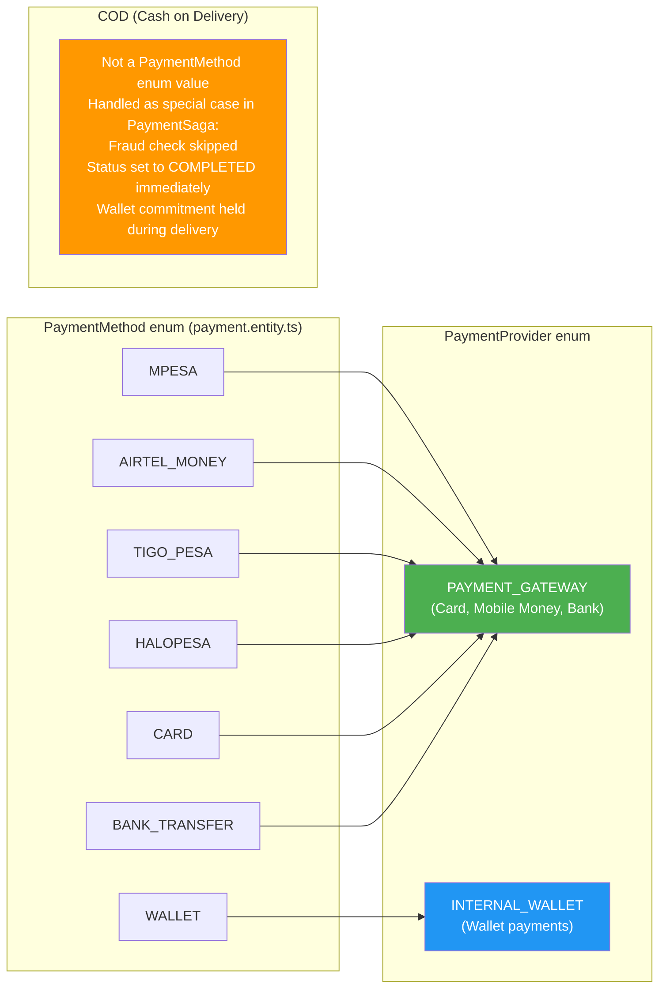
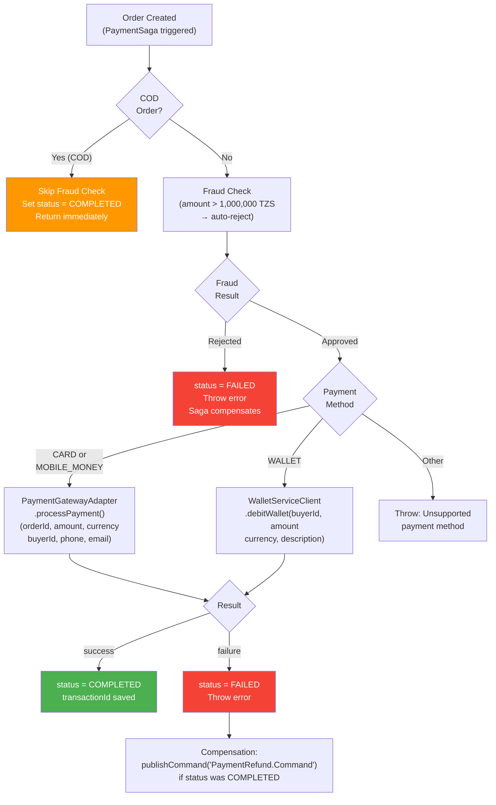
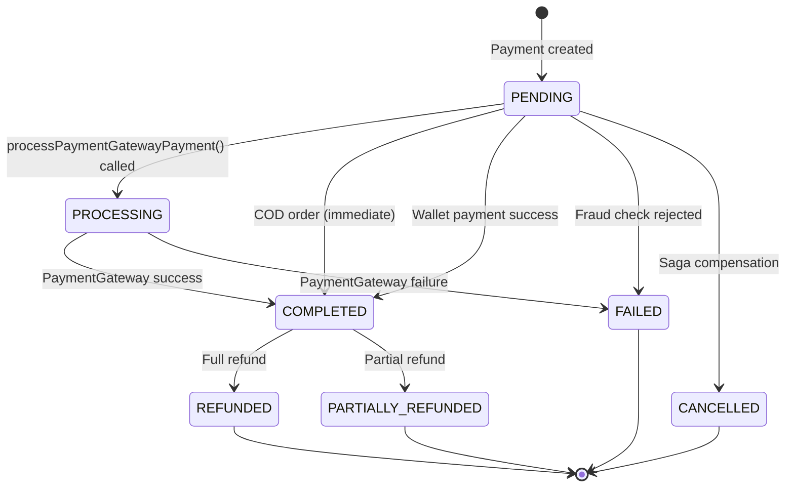
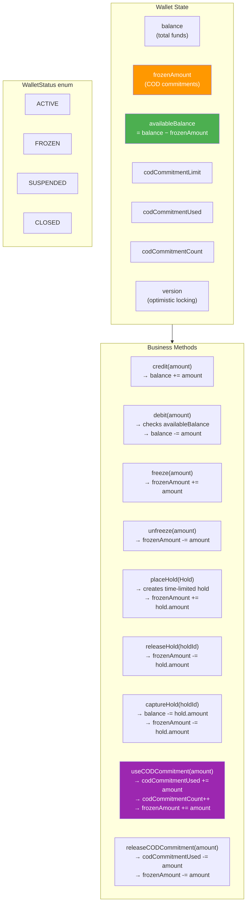
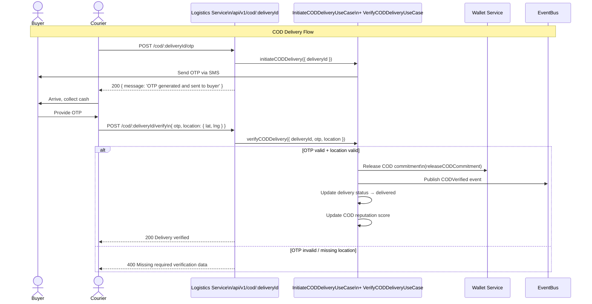
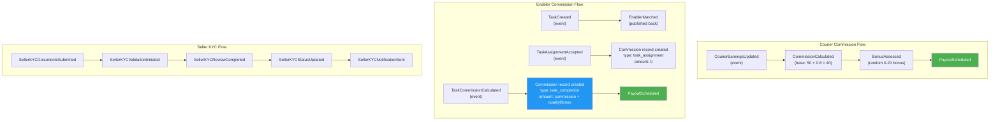
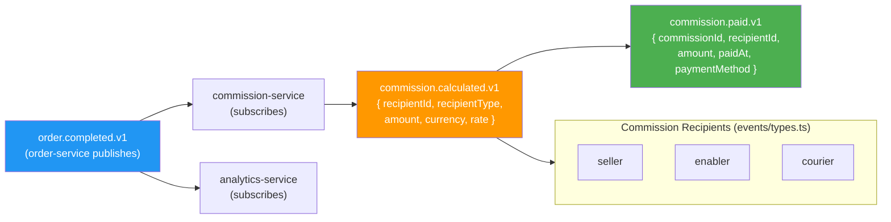

# Maysar Express — Revenue & Payment Flow Diagrams

> **Evidence-based** — built from reading actual source files.
> Sources: `services/order-service/src/application/sagas/payment.saga.ts`, `services/payment-service/src/domain/entities/payment.entity.ts`, `services/wallet-service/src/domain/entities/wallet.entity.ts`, `services/commission-service/commissionService.ts`, `services/logistics-service/src/api/controllers/cod.controller.ts`

---

## 1. Payment Methods (Actual — from payment.entity.ts)

---

## 2. Payment Processing Flow (Actual — from payment.saga.ts)

---

## 3. Payment Status Transitions (Actual — from payment.entity.ts)

---

## 4. Wallet Entity Operations (Actual — from wallet.entity.ts)

---

## 5. COD Escrow Flow (Actual — from cod.controller.ts + logistics routes)

---

## 6. Commission Service Event Handlers (Actual — from commissionService.ts)

---

## 7. Revenue Flow (Actual Event Catalog — events/CATALOG.md)

