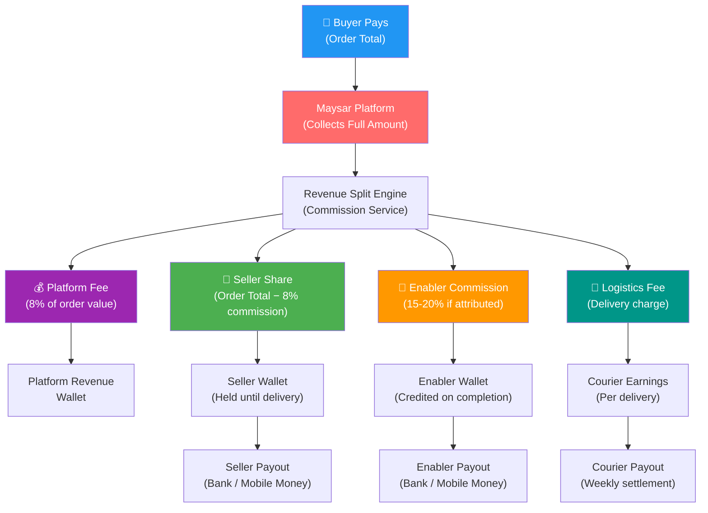
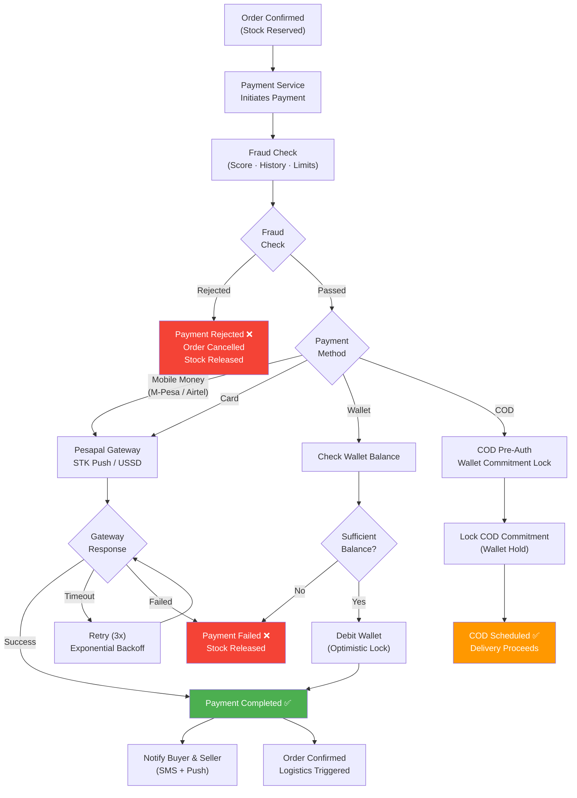
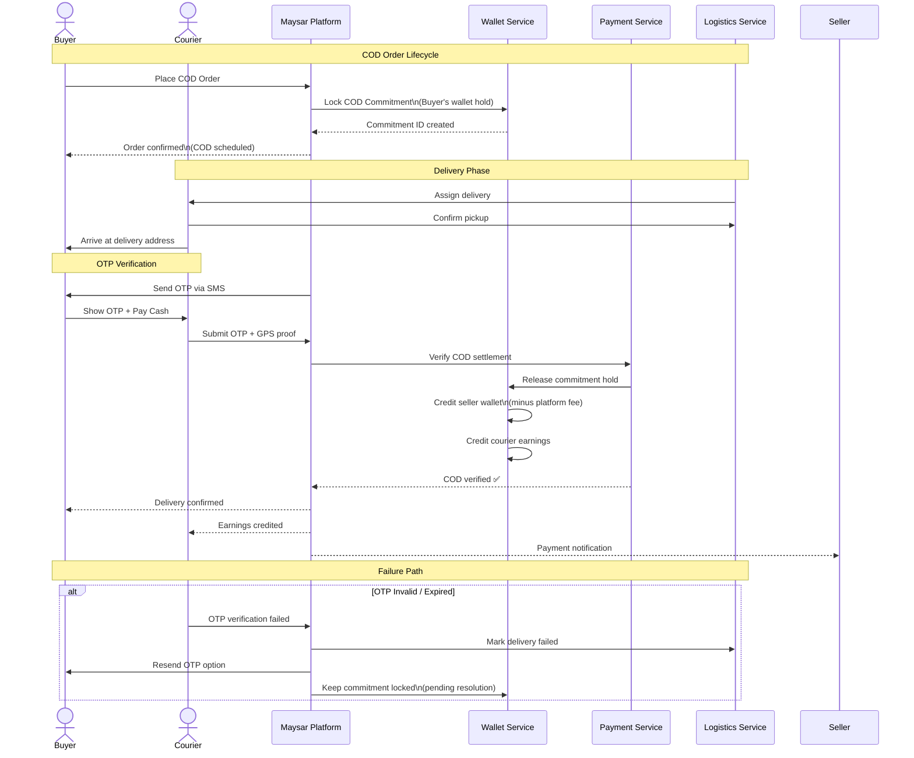
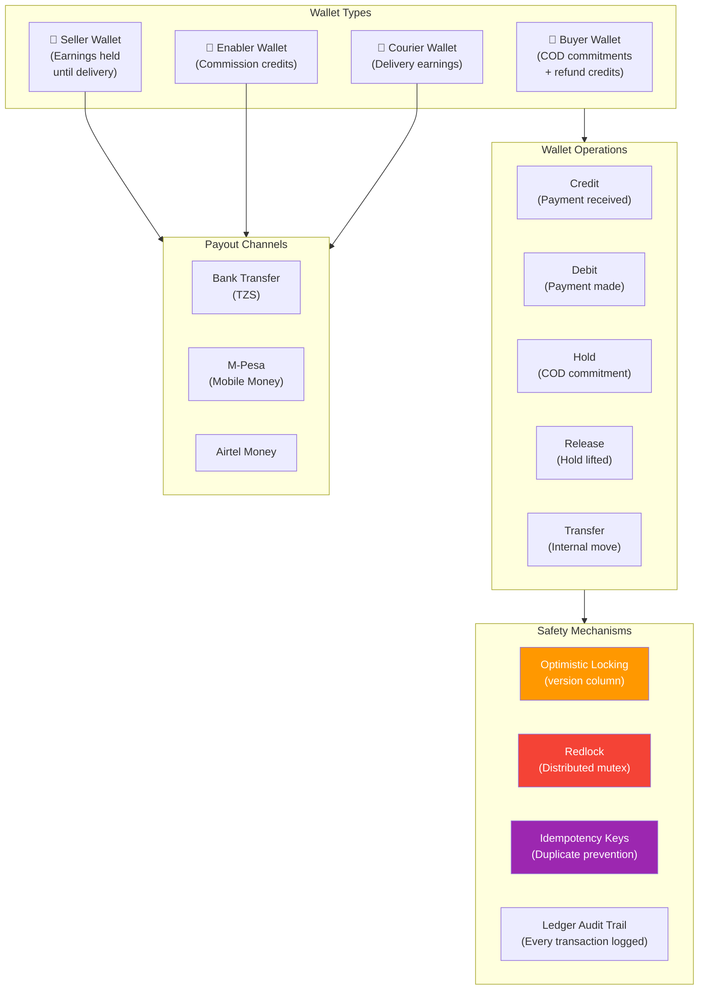
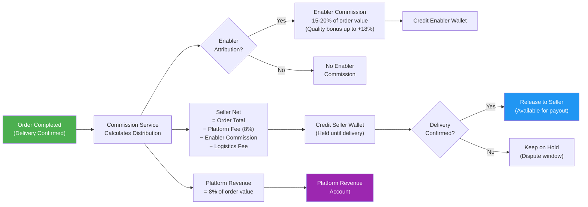
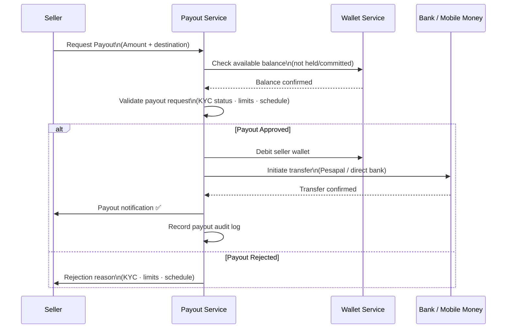

# Maysar Express — Revenue & Payment Flow Diagrams

> Covers: payment processing, COD escrow, wallet mechanics, commission distribution, and payout flows.

---

## 1. Revenue Flow Overview

---

## 2. Payment Processing Flow (All Methods)

---

## 3. COD (Cash on Delivery) Escrow Flow

---

## 4. Wallet Architecture

---

## 5. Commission Distribution Flow

---

## 6. Payout Settlement Flow

