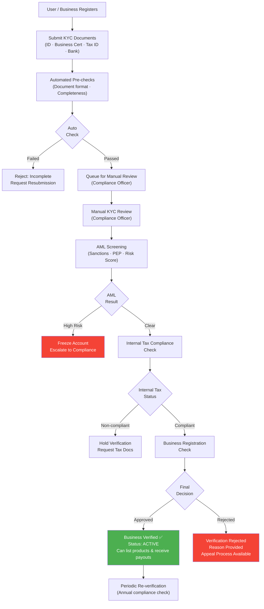
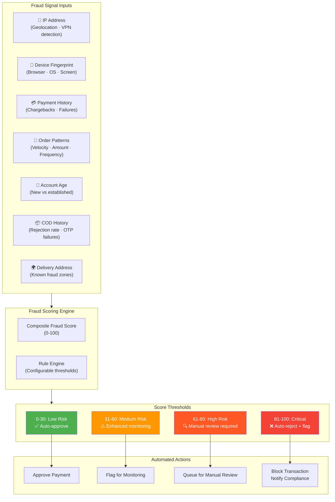
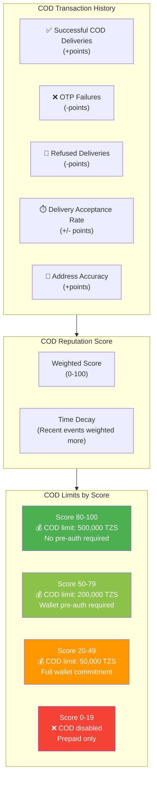
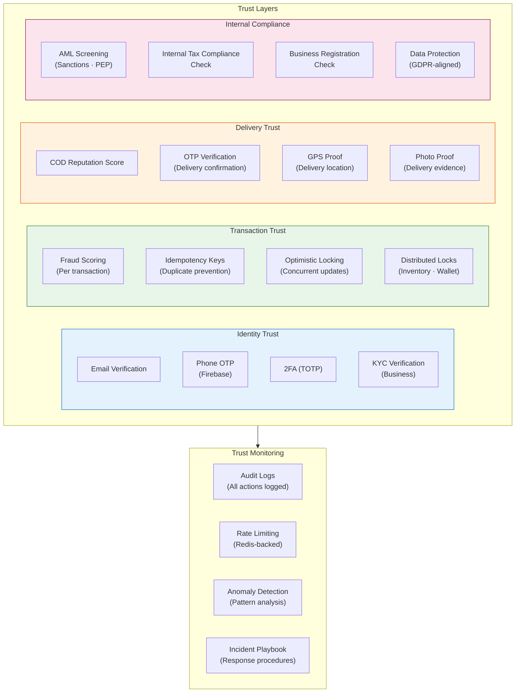
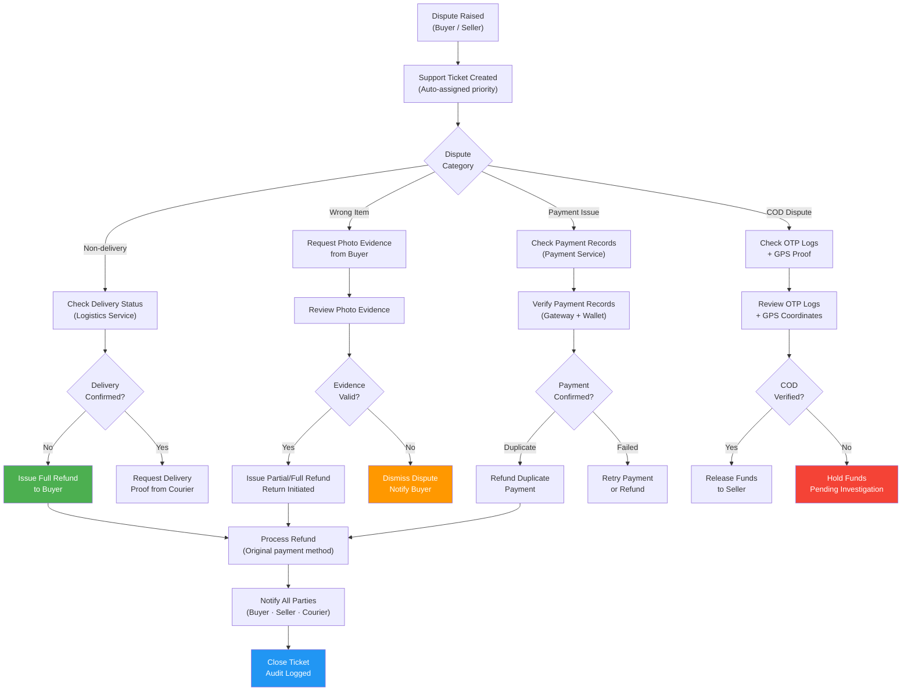

# Maysar Express — Trust & Compliance Diagrams

> Covers: KYC/AML flows, fraud scoring, COD reputation, compliance checks, and platform trust mechanisms.

---

## 1. KYC Verification Flow

---

## 2. Fraud Scoring System

---

## 3. COD Reputation Scoring

---

## 4. Platform Trust Architecture

---

## 5. Dispute Resolution Flow

