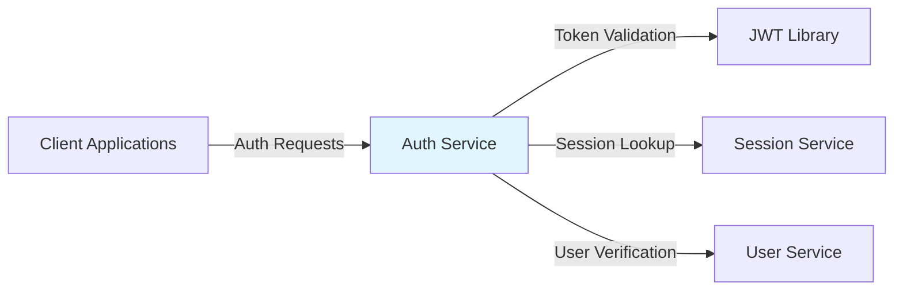

# Auth Service - Modeling Documentation

## Service Classification

**Type:** Infrastructure Service (Stateless Authentication)

## Why Limited Modeling Diagrams?

The auth-service is an **authentication infrastructure service** that provides stateless authentication operations. It contains minimal business logic requiring detailed state machine or saga diagrams.

## Service Purpose

This service provides:
- Token generation and validation
- Authentication checks
- Session management integration
- Security policy enforcement

## Architecture Reference

## Existing Diagrams

### Sequence Diagrams

The service includes a basic authentication flow diagram showing token validation and session management.

## Integration Points

Other services integrate with auth-service through:
- **Synchronous API calls** for token validation
- **Middleware pattern** for request authentication
- **Request-Response pattern** for immediate auth decisions

## Compliance Note

This service follows the modeling constitution by:
- Documenting its infrastructure/utility nature
- Providing diagrams where business logic exists
- Avoiding unnecessary diagrams for stateless operations

Last Updated: 2026-02-07
