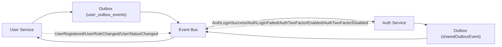

# Auth <-> User Two-Way Sync

## Purpose
This document describes the two-way synchronization between Auth Service and User Service. The goal is to keep authentication state and user profile data consistent while enforcing clear ownership of fields to prevent conflicting writes.

## Executive Summary
1. Each field has one owner; the other service only mirrors it via events.
2. User Service owns profile/identity data; Auth Service owns security state.
3. Both sides publish to outbox and best-effort to the event bus.
4. Consumers update only their mirror fields and never re-emit back.
5. This avoids drift, supports retries, and keeps credentials isolated.

## Design Principles
1. Single-writer per field: each field has one authoritative service.
2. Events drive sync: changes are emitted as domain events and consumed by the other service.
3. Idempotent updates: repeated events should not corrupt state.
4. Security isolation: credential material stays inside Auth Service.

## Field Ownership
Auth Service owns security state:
- `passwordHash`
- `failedLoginAttempts`
- `lockoutUntil`
- `lastLoginAt`
- `twoFactorEnabled`
- `twoFactorSecret`
- `Auth_*Token` tables

User Service owns identity and profile:
- `email`
- `phoneNumber`
- `firstName`, `lastName`, `avatar`
- `role`, `status`
- verification flags (`isEmailVerified`, `isPhoneVerified`)
- preferences, addresses, COD reputation

## Event Flows
### User Service <-> Auth Service
Events published by User Service and consumed by Auth Service to update `auth_users`:
- `UserRegistered`
- `UserRoleChanged`
- `UserStatusChanged`
- `UserEmailVerified`
- `UserPhoneVerified`
- `UserProfileUpdated` (only for email/phone changes)

Implementation:
- User Service persists domain events to `user_outbox_events` and publishes best-effort to the in-process bus.
- Auth Service consumes and updates `auth_users` with normalized role/status.

### Auth Service <-> User Service
Events published by Auth Service and consumed by User Service to update `users`:
- `AuthLoginSuccess`
- `AuthLoginFailed`
- `AuthTwoFactorEnabled`
- `AuthTwoFactorDisabled`

Implementation:
- Auth Service persists events to `sharedOutboxEvent` and publishes best-effort to the in-process bus.
- User Service consumes and updates `users` with login counters, lockout state, and 2FA enablement.

## Current Implementation (March 2026)
Auth <-> User publishing:
- `AuthEventPublisher` saves envelopes to outbox and publishes to event bus.
- `AuthenticateUserUseCase` emits `AuthLoginSuccess` / `AuthLoginFailed`.
- 2FA use cases emit `AuthTwoFactorEnabled` / `AuthTwoFactorDisabled`.

User <-> Auth publishing:
- `UserEventPublisher` saves envelopes to user outbox and publishes to event bus.
- User use cases emit `UserRegistered`, `UserRoleChanged`, `UserStatusChanged`, `UserEmailVerified`, `UserPhoneVerified`, `UserProfileUpdated`.

## User Flow (End-to-End)
1. User registers in User Service.
2. User Service writes `users` and emits `UserRegistered`.
3. Auth Service consumes and upserts `auth_users` for authentication flow.
4. User logs in via Auth Service.
5. Auth Service updates login state and emits `AuthLoginSuccess` or `AuthLoginFailed`.
6. User Service consumes and mirrors login counters/lockout state for profile visibility and admin tooling.

## Architecture Diagram

## Failure Modes and Resilience
- If event publish fails after outbox save, the event remains durable in the outbox table for retry by an outbox processor.
- If consumer update fails (e.g., missing user), the consumer logs and continues. This is safe because user creation is authoritative in User Service.
- The in-process bus provides immediate propagation in a single-node setup. For multi-node production, enable a shared outbox processor.

## Data Consistency Rules
1. Auth Service must never overwrite user-owned fields (email, role, status) except when consuming user events.
2. User Service must never overwrite auth-owned fields (password hash, 2FA secret) except when consuming auth events.
3. Sync events must not trigger recursive writes back to the same owning service.

## Observability
Recommended logs and metrics:
- Auth Service: count of `AuthLoginSuccess` and `AuthLoginFailed` published.
- User Service: count of auth sync updates applied.
- Outbox backlog size per service.

## Operational Notes
- For strict consistency across services, run a scheduled outbox publisher and consumer in each service.
- If a user is missing in User Service for an auth event, the event is ignored and logged. The correct fix is to ensure User Service remains the system of record for account creation.

## Open Extensions
- Add idempotency keys and event version checks to guard against out-of-order delivery.
- Add `AuthPasswordChanged` event to update user-facing audit metadata without exposing hashes.
- Add a reconciliation job for periodic diff/repair.
