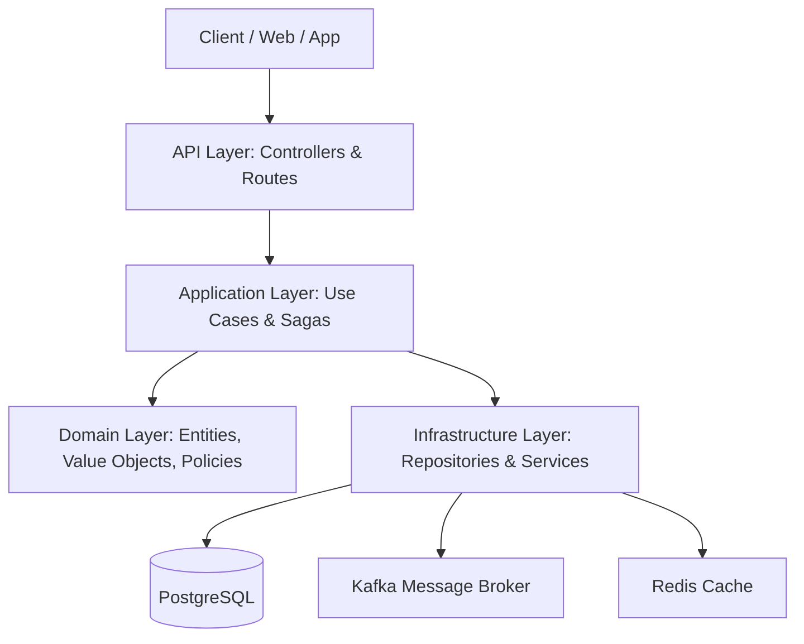
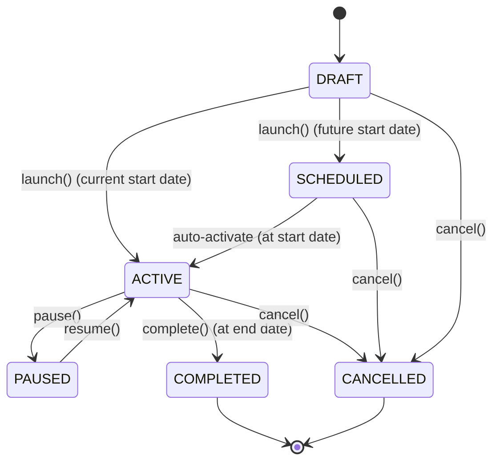

# Campaign Service Architecture

The Campaign Service is a core module within the Maysar platform, responsible for managing promotional activities. It adheres to Clean Architecture and Domain-Driven Design (DDD) principles.

## System Components

### 1. Domain Layer (`src/domain`)
The heart of the service, containing all business logic and rules. It is independent of any external frameworks or libraries.

- **Entities**: 
  - `Campaign`: Aggregate root managing the lifecycle and state of a campaign.
  - `CampaignPricingRule`: Defines specific pricing logic.
  - `CampaignCondition`: Defines when a rule should be applied.
- **Value Objects**: `CampaignSchedule`, `PricingRuleValue`, `CampaignMetadata`.
- **Policies**: `CampaignValidationPolicy`, `CampaignSecurityPolicy`.
- **Events**: Domain events like `CampaignCreatedEvent`, `CampaignLaunchedEvent`.

### 2. Application Layer (`src/application`)
Coordinates the execution of business logic and handles data flow.

- **Use Cases**: Encapsulate specific business actions (e.g., `CreateCampaignUseCase`).
- **Sagas**: Orchestrate multi-step processes or cross-service interactions.
  - `CampaignLifecycleSaga`: Manages the overall state transitions of a campaign.
  - `CampaignPricingSaga`: Handles the application and reversion of promotional prices.
  - `CampaignSchedulingSaga`: Manages the automated activation and deactivation based on schedules.
- **DTOs / Mappers**: Data transfer objects and mappers for converting between layers.

### 3. Infrastructure Layer (`src/infrastructure`)
Provides technical implementations for domain and application interfaces.

- **Prisma Repository**: Uses Prisma ORM for database operations with transactional support.
- **Event Publisher**: Implements the transactional outbox pattern for reliable event delivery.
- **Logger Service**: Standardized logging throughout the service.
- **Scheduler Service**: Handles delayed or recurring tasks.

### 4. API Layer (`src/api`)
Handles HTTP requests and responses.

- **Controllers**: Inversify-managed controllers that delegate work to use cases.
- **Routes**: Standard Express routes integrated with the monolithic module registry.

### Campaign Lifecycle State Machine

## Data Model

The service uses a normalized schema to ensure data integrity and flexibility.

- `Campaign`: Core data.
- `PricingRule`: Multiple rules per campaign.
- `Condition`: Multiple conditions per rule or campaign.
- `CampaignProduct` / `CampaignCategory`: Junction tables for targeting.
- `Metrics`: Performance data tracked over time.
- `OutboxEvent`: For reliable event publishing.
