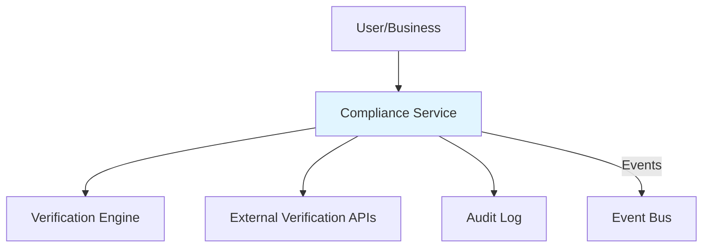

# Compliance Service - Modeling Documentation

## Service Classification

**Type:** Domain Service (Compliance Management)

## Service Purpose

This service provides compliance and regulatory management capabilities:
- KYC/AML verification workflows
- Regulatory requirement tracking
- Compliance policy enforcement
- Audit trail management

## Existing Diagrams

### Sequence Diagrams

The service includes diagrams documenting compliance verification workflows and policy enforcement flows.

## Architecture Reference

## Integration Points

Other services integrate with compliance-service through:
- **Event-driven workflows** for verification requests
- **Policy evaluation APIs** for compliance checks
- **Audit logging** for regulatory requirements

## Future Enhancements

As compliance workflows mature, additional diagrams will be added for:
- State machines for verification statuses
- Saga diagrams for multi-step compliance processes
- Use case diagrams for regulatory scenarios

## Alignment with Code

Diagrams reflect current implementation in:
- `src/application/` - Compliance workflows
- `src/domain/policies/` - Compliance policies
- `src/infrastructure/` - External integrations

Last Updated: 2026-02-07
