# Enabler Service Modeling Diagrams

## Domain Class Diagram

```mermaid
classDiagram
    class Enabler {
        +String id
        +String userId
        +String businessName
        +EnablerStatus status
        +EnablerTier tier
        +Float commissionRate
        +Float totalSales
        +Float totalOrders
        +Float conversionRate
        +Float customerRating
        +approve()
        +activate()
        +suspend()
        +reject()
        +upgradeTier()
        +downgradeTier()
        +updatePerformanceMetrics()
    }

    class ProductListing {
        +String id
        +String enablerId
        +String productId
        +String sellerId
        +ListingStatus status
        +Boolean visibility
        +Float customPrice
        +Float priceMarkup
        +Boolean sellerApproved
        +activate()
        +pause()
        +remove()
        +updateTerms()
        +updatePricing()
        +approveBySeller()
    }

    class EnablerOrder {
        +String id
        +String enablerId
        +String orderId
        +String sellerId
        +String buyerId
        +String productListingId
        +OrderStatus status
        +Float orderAmount
        +Float enablerCommission
        +String settlementStatus
        +String disputeStatus
        +confirm()
        +startProcessing()
        +complete()
        +cancel()
        +raiseDispute()
        +resolveDispute()
        +markSellerPaid()
        +markEnablerPaid()
    }

    class EnablerCommission {
        +String id
        +String enablerId
        +String enablerOrderId
        +Float baseCommission
        +Float tierBonus
        +Float performanceBonus
        +Float totalCommission
        +String status
        +Date holdUntil
        +String fraudCheckStatus
        +approve()
        +putOnHold()
        +releaseHold()
        +flagForFraud()
        +markAsPaid()
        +raiseDispute()
        +forfeit()
    }

    Enabler "1" -- "*" ProductListing : manages
    Enabler "1" -- "*" EnablerOrder : facilitates
    Enabler "1" -- "*" EnablerCommission : earns
    ProductListing "1" -- "*" EnablerOrder : generates
    EnablerOrder "1" -- "1" EnablerCommission : yields
```

## Entity States

### Enabler Status
- PENDING: Awaiting approval
- APPROVED: Approved but not yet active
- ACTIVE: Fully operational
- SUSPENDED: Temporarily disabled
- REJECTED: Application denied

### Order Status
- PENDING: Created, awaiting confirmation
- CONFIRMED: Enabler accepted
- PROCESSING: Fulfillment in progress
- COMPLETED: Delivered and finalized
- CANCELLED: Terminated before completion
- DISPUTED: Under review
