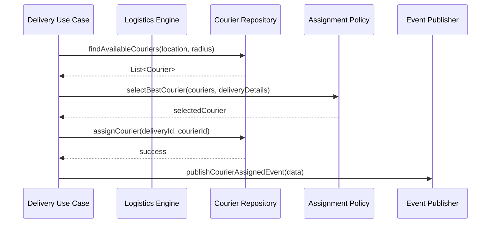

# Courier Assignment Sequence

## Flow Description

1. **Discovery**: The system searches for active couriers within a specified radius of the pickup point.
2. **Selection**: An assignment policy evaluates couriers based on rating, distance, and current load.
3. **Persistence**: The chosen courier is linked to the delivery in the database, and their availability is updated.
4. **Notification**: A domain event is broadcasted to inform other services (e.g., Notification Service).
