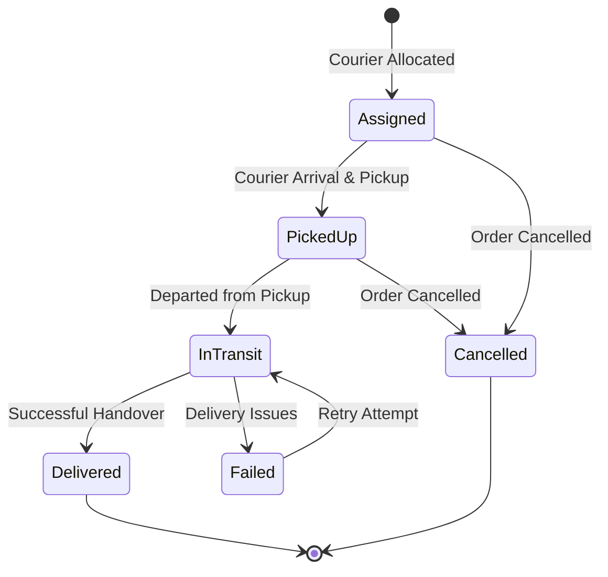

# Delivery Life Cycle State Machine

## States Description

- **Assigned**: A courier has been selected and the delivery task is pending pickup.
- **PickedUp**: The courier has physically received the items from the source.
- **InTransit**: The courier is currently traveling towards the destination.
- **Delivered**: The items have been successfully handed over to the recipient.
- **Failed**: The delivery attempt was unsuccessful (e.g., recipient not home).
- **Cancelled**: The delivery was aborted by the customer or the system.
