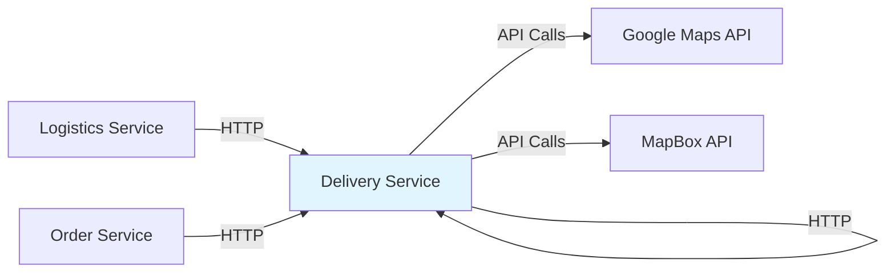

# Maps Service - Modeling Documentation

## Service Classification

**Type:** Pure Utility Service (Stateless)

## Why No Detailed Modeling Diagrams?

The maps-service is a **stateless utility service** that provides location-based functionality through pure computational operations. It does not contain:
- ✗ Sagas or orchestration workflows
- ✗ Stateful domain entities with lifecycle transitions
- ✗ Complex business logic requiring state machines

## Service Purpose

This service provides:
- Geocoding (address ↔ coordinates conversion)
- Reverse geocoding
- Distance calculations
- Route optimization
- Geographic proximity searches

## Integration Points

Other services integrate with maps-service through:
- **Synchronous API calls** for immediate location queries
- **Request-Response pattern** (no async saga orchestrations)

## Architecture Reference

## Documentation Location

For detailed implementation documentation, see:
- API specification: `src/api/routes/`
- Use cases: `src/application/use-cases/`
- Infrastructure: `src/infrastructure/providers/`

## Compliance with Modeling Constitution

According to the Software Modeling Constitution:
> "Diagrams must serve a purpose. Stateless utility services without sagas or entity lifecycles do not require state machines or sequence diagrams."

This service complies by documenting its utility nature rather than forcing unnecessary diagrams.

Last Updated: 2026-02-07
